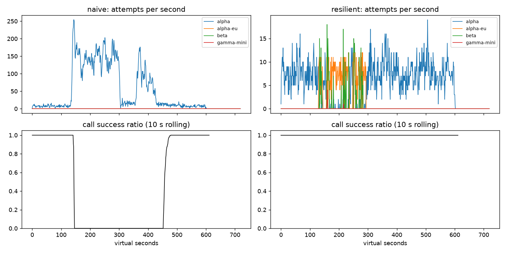

# Lab 25B — Report

**Họ tên / nhóm:** Lê Quang Ngọc — **MSV:** 2A202602664  
**Điểm tự động (`python scripts/grade.py`):** 84 / 88 (4 điểm dữ liệu SLO ẩn không có trong repo local)

Mọi số liệu dưới đây lấy từ `reports/gameday/*.json`, `reports/workflows.json`, `reports/slo.json`, `reports/cache/*.json` và `reports/experiments/` với seed 25.

## 1. Kết quả Game Day (naive vs resilient)

| Băng | Client | availability | p95 (s) | amplification | retry_ratio | cost/turn | recovery (s) | PASS? |
|---|---|---:|---:|---:|---:|---:|---:|:---:|
| G1 | naive | 0,7194 | 7,157 | 7,738 | 6,738 | 2,163 | 4 | Không |
| G1 | resilient | 1,0000 | 4,776 | 1,062 | 0,002 | 2,101 | 0 | Có |
| G2 | naive | 0,4560 | 15,034 | 9,904 | 8,904 | 4,627 | 155 | Không |
| G2 | resilient | 1,0000 | 10,920 | 1,041 | 0,007 | 2,119 | 0 | Có |
| G3 | naive | 1,0000 | 4,768 | 1,164 | 0,164 | 2,328 | 0 | Không |
| G3 | resilient | 1,0000 | 4,660 | 1,060 | 0,034 | 2,145 | 0 | Có |
| G4 | naive | 1,0000 | 13,764 | 1,004 | 0,004 | 2,008 | 0 | Không |
| G4 | resilient | 1,0000 | 5,562 | 1,015 | 0,002 | 2,072 | 0 | Có |
| G5 | naive | 0,3699 | 5,359 | 17,030 | 16,030 | 2,124 | N/A | Không |
| G5 | resilient | 0,8179 | 5,477 | 1,003 | 0,002 | 2,504 | N/A | Có |
| G6 | naive | 0,5170 | 4,836 | 12,344 | 11,344 | 2,009 | 0 | Không |
| G6 | resilient | 1,0000 | 5,961 | 1,055 | 0,019 | 2,189 | 0 | Có |

Resilient client đạt 6/6 băng. Cải thiện lớn nhất là G2: availability tăng từ 45,60% lên 100%, amplification giảm từ 9,904 xuống 1,041 và recovery giảm từ 155 giây xuống 0 giây.

## 2. Cấu hình client và lý do

| Tham số | Giá trị | Vì sao |
|---|---:|---|
| attempt_timeout_s | 8,0 | Đủ lớn so với latency bình thường 1,2–1,8 giây nhưng còn chỗ trong deadline 30 giây để failover. Đặt 30 giây làm G6 giảm availability từ 1,0000 xuống 0,9488. |
| max_attempts_per_provider | 2 | Cho phép một retry transient nhưng chuyển provider sớm; cấu hình hiện tại giữ G2 amplification ở 1,041. |
| backoff_base_s / cap_s | 0,25 / 4,0 | Full jitter phân tán retry; cap 4 giây vẫn còn đủ thời gian failover trong deadline. G1 có 0 vi phạm `retry-after`. |
| retry_budget_ratio | 0,1 | Chặn retry storm. Khi breaker bị vô hiệu hóa, budget giữ G2 amplification 1,380 thay vì 1,675 và G3 retry ratio 0,068 thay vì 0,159. |
| breaker.window_size / min_calls | 20 / 10 | Cửa sổ đủ nhạy nhưng không trip từ vài lỗi lẻ; G3 availability vẫn 100%. |
| breaker.failure_rate_threshold | 0,5 | Cắt provider khi ít nhất nửa số kết quả gần nhất lỗi; G2 recovery còn 0 giây. |
| breaker.slow_call_s | 5,0 | Phát hiện G4 dù provider vẫn success; p95 giảm từ 13,764 xuống 5,562 giây. |
| breaker.open_duration_s | 10,0 | Tránh dồn probe khi provider chưa hồi phục nhưng kiểm tra lại đủ nhanh; G2 traffic quay lại primary và recovery 0 giây. |
| breaker.half_open_max_probes | 2 | Giới hạn herd khi hồi phục trong khi vẫn có thể thu đủ 2 success để đóng breaker. |

Decision table của `on_error`:

| Loại lỗi | Ghi breaker? | Retry cùng provider? | Failover/cooldown |
|---|---|---|---|
| CLIENT_ERROR | Không, trả permit | Không | Không; `GiveUp(client_error)` |
| QUOTA_EXHAUSTED | Không, trả permit | Không | Cooldown 300 giây rồi failover |
| RATE_LIMITED | Không, trả permit | Không | Cooldown theo `retry_after`, failover ngay |
| OVERLOADED / SERVER_ERROR / TIMEOUT | Có | Một lần nếu budget và deadline cho phép | Failover nếu retry không còn phù hợp |

## 3. Ba thí nghiệm

1. **Retry budget là lớp phòng thủ cuối.** Với `breaker.min_calls=1000000000` và `max_attempts_per_provider=5`, khi giữ budget, G2 có amplification 1,380, retry ratio 0,058, recovery 0 giây; G3 lần lượt là 1,136, 0,068, 0 giây. Khi tắt budget, G2 tăng lên 1,675, 0,495 và recovery 25 giây; G3 tăng lên 1,162 và 0,159. Khi breaker hoạt động đúng, G2 chỉ còn amplification 1,041, nhưng vẫn cần budget làm chốt chặn khi breaker cấu hình sai, chưa đủ mẫu hoặc gặp kết quả đến muộn.

2. **`attempt_timeout_s=30`.** G6 availability giảm từ 1,0000 xuống 0,9488 và FAIL, trong khi p95 của các lượt thành công giảm từ 5,961 xuống 5,315 giây: đây là survivorship bias vì lượt treo đến deadline không nằm trong p95 success. G4 gần như không đổi (availability 1,0000; p95 5,608 so với 5,562) vì slow-call breaker phát hiện độ chậm 5 giây trước khi timeout 30 giây có vai trò. Timeout nên dựa vào p99 bình thường, deadline người dùng và phần thời gian phải dành cho ít nhất một lần failover; 8 giây đáp ứng cả ba.

3. **Bỏ lọc tool calling khỏi `ladder()`.** G6 tạo 234 `incompatible_routes`, availability giảm từ 1,0000 xuống 0,9019 và FAIL. Theo ngôn ngữ sản phẩm: 234 lượt đã được gửi tới model rẻ nhưng không biết gọi công cụ, nên dù hạ tầng trả lời được, kết quả không thể hoàn thành tác vụ và người dùng vẫn thất bại.

## 4. Workflow hoàn tiền

| Executor | completion | crashes | duplicate refunds | duplicate emails | lost refunds | overpaid | wasted LLM / crash |
|---|---:|---:|---:|---:|---:|---:|---:|
| naive | 1,000 | 81 | 128 | 81 | 0 | 1.496.700 cent | 1,123 |
| yours | 1,000 | 66 | 0 | 0 | 0 | 0 cent | 0,303 |

Idempotency key ngăn payment/email thực thi side effect lần hai khi response bị mất hoặc worker khởi động lại, nhưng một mình nó không tránh chạy lại các bước LLM/lookup và không cho worker biết workflow đã đi tới đâu. Checkpoint cho phép resume và tránh lãng phí, nhưng một mình checkpoint không che được khoảng trống giữa side effect đã commit và lúc ghi checkpoint. Nếu checkpoint trước khi gọi payment, crash sau checkpoint nhưng trước payment sẽ làm worker mới bỏ qua bước đó và gây mất refund. Vì vậy thứ tự đúng là gọi với stable idempotency key, nhận success rồi mới checkpoint.

## 5. Alerting và error budget

| Sự cố | Mong đợi | Naive alerter | Burn-rate alerter | Độ trễ burn-rate (phút) |
|---|---|---|---|---:|
| checkout_bug | page | page | page | 27 |
| provider_outage | page | page | page | 4 |
| deploy_blip | none | page sai | none | N/A |
| slow_leak | ticket | bỏ sót | ticket | 1337 |
| degraded_evening | page | page | page | 291 |
| night_spike | none | page sai | none | N/A |
| small_bump | none | page sai | none | N/A |

Trong 25.901.755 request, budget cho phép 129.508,8 request lỗi; thực tế có 55.618 lỗi. Đã tiêu 42,95%, còn 57,05%, availability là 99,7853%, vì vậy chưa đóng băng release. `small_bump` kéo dài 20 phút ở 12% lỗi không nên đánh thức on-call vì không đồng thời vượt cả cửa sổ dài và ngắn của burn-rate rule; một spike ngắn chưa đe dọa đủ phần budget tháng.

## 6. Postmortem — G2 với naive client (blameless)

**Tóm tắt.** Từ t=120, alpha mất 75% năng lực và client naive khuếch đại tải do ba tầng retry cố định. 1.285/2.362 lượt user thất bại, availability chỉ 45,60%, amplification 9,904 và sự cố kéo dài khoảng 335 giây đến t≈455. Provider hồi phục ở t=300 nhưng hàng đợi retry khiến hệ thống mất thêm 155 giây mới hồi phục.

**Ảnh hưởng.** Có 1.285 lượt thất bại; p95 của lượt thành công là 15,034 giây và cost/good-turn tăng lên 4,627. Với traffic danh nghĩa 4 lượt/giây trong 30 ngày, budget 0,5% tương đương 51.840 lượt lỗi; sự cố này tiêu khoảng 2,48% budget tháng, chưa vượt toàn bộ budget nhưng chỉ trong vài phút đã đốt một phần không cân xứng.

| t (s) | Sự kiện | Bằng chứng từ CSV |
|---:|---|---|
| 119 | Trạng thái trước sự cố | 7/7 call hoàn tất thành công, 9 attempt alpha/s |
| 120 | Alpha mất 75% năng lực | 7/7 call thành công, 5 attempt/s; queue bắt đầu tích tụ ngay sau mốc này |
| 180 | Retry storm đã hình thành | 0/5 call thành công, 138 attempt alpha/s |
| 240 | Hệ thống tiếp tục quá tải | 0/2 call thành công, 105 attempt alpha/s |
| 299 | Ngay trước restore | 0/1 call thành công, 136 attempt alpha/s |
| 300 | Alpha hồi phục hoàn toàn | vẫn 0/5 call thành công với 115 attempt/s |
| 360 | Sau restore 60 giây vẫn chưa ổn định | 0/1 call thành công, 50 attempt/s |
| 420 | Sau restore 120 giây vẫn có backlog | 0/2 call thành công, 53 attempt/s |
| 455 | Hồi phục | 4/5 call thành công, attempt giảm còn 13/s; metric recovery là 155 giây |

**Trigger vs root cause.** Trigger là alpha mất 75% GPU trong ba phút. Root cause là thiết kế client có app × gateway × SDK retry chồng nhau, delay cố định, không jitter, không retry budget, không breaker và không fallback. Mỗi timeout sinh thêm request trong khi request cũ vẫn chạy ở server; queue vì thế chứa cả công việc mà client đã bỏ. Sau t=300, retry mới cộng với backlog cũ vẫn giữ offered load lớn hơn năng lực phục vụ, tự duy trì vòng lặp metastable cho tới t≈455.

**Điều gì giúp / làm tệ hơn.** Provider cuối cùng tự thoát backlog khi attempt/s giảm; không có cơ chế chủ động nào của naive client giúp phục hồi. Timeout phía client trong khi server vẫn xử lý, retry ba tầng và delay đồng bộ làm tải nặng hơn. Resilient client đối chứng cho availability 100%, amplification 1,041 và recovery 0 giây nhờ breaker, budget, jitter và failover.

| # | Hành động | Loại | Owner | Cách kiểm chứng |
|---:|---|---|---|---|
| 1 | Chuẩn hóa retry tại đúng một tầng, bật full jitter và budget 10% | prevent | Agent Platform | CI G2: amplification ≤ 1,6 và retry ratio theo budget |
| 2 | Phát hành sliding-window breaker có slow-call detection và giới hạn 2 half-open probe | mitigate | Reliability | CI G2 recovery ≤ 30 giây; G4 p95 ≤ 10 giây |
| 3 | Dashboard/alert cho attempt amplification, queue wait và breaker transitions | detect | SRE | Synthetic incident phải page khi amplification vượt 1,6 trong hai cửa sổ |
| 4 | Duy trì capability-aware fallback và diễn tập Game Day đa seed trước release | mitigate | On-call + QA | G1–G6 PASS mọi seed, incompatible routes = 0 |

## 7. Một điểm yếu còn lại

G2 vẫn có p95 10,920 giây dù availability 100%, và beta có giá 1,4/call nên failover kéo dài sẽ tăng latency lẫn chi phí. Nếu cả bốn provider cùng chậm nhưng chưa lỗi, từng breaker cần đủ mẫu trước khi mở và có thể luân phiên dồn tải. Bước tiếp theo là adaptive concurrency limit dựa trên queue latency, deadline-aware hedging với budget riêng và routing theo health/cost thay vì ladder tĩnh; tiêu chí là giữ p95 G2 dưới 10 giây mà amplification không vượt 1,2.

## 8. Cache

| Client | availability | faq_availability | cache_hit_ratio | stale_served | wrong_answers | outdated_answers | cost/turn | PASS? |
|---|---:|---:|---:|---:|---:|---:|---:|:---:|
| resilient (không cache) | 0,8373 | 0,8424 | 0,000 | 0 | 0 | 0 | 1,386 | Không |
| cached | 0,9124 | 0,9645 | 0,652 | 157 | 0 | 3 | 0,915 | Có |

| Tham số `cache:` | Giá trị | Vì sao |
|---|---:|---|
| similarity_threshold | 0,90 | 0,80 gây 181 lỗi `other_question`; 0,90 giữ wrong=0 và hit=65,2%. |
| ttl_s | 60 | TTL 300 gây 95 outdated; TTL 60 chỉ còn 3 và vẫn đạt hit 65,2%. |
| max_stale_s | 600 | Bao phủ outage 120 giây; phục vụ 157 stale và nâng FAQ availability lên 96,45%. |

1. **Ngưỡng.** Ở 0,80: hit ratio 74,2%, 181 câu sai, cost/turn 0,921; các cặp gần nhưng khác như refund policy/refund time, size/color và ship nội thành/ngoại tỉnh bị trộn. Ở 0,90: hit 65,2%, wrong=0, cost 0,915. Ở 0,97: hit giảm còn 57,9%, wrong=0 và cost tăng lên 0,965; vì vậy 0,90 cân bằng an toàn và hiệu quả.

2. **TTL.** TTL 30/60/300 giây lần lượt cho hit 59,2%/65,2%/73,1%, outdated 2/3/95 và cost 0,955/0,915/0,863. Webhook xử lý thay đổi refund đã được báo, nhưng thay đổi phí ship ở t=480 không có webhook nên không thể invalidate chủ động; TTL là giới hạn duy nhất cho thời gian câu trả lời cũ còn fresh. TTL 60 đạt cả freshness và hit-rate.

3. **Stale-if-error.** Với `max_stale_s=0`, FAQ availability chỉ 87,33%, stale served=0 và băng FAIL. Với 600 giây, FAQ availability tăng lên 96,45% và 157 câu được phục vụ stale trong outage.

Câu hỏi cá nhân không được cache ngay cả khi chia theo user vì trạng thái order/refund/điểm thay đổi nhanh, quyền truy cập có thể đổi và key/scope sai vẫn có thể làm lộ dữ liệu; lợi ích latency không đáng đổi lấy rủi ro riêng tư và tính đúng. Khi cache giữ dashboard availability xanh trong lúc provider sập, on-call cần alert trên provider-attempt availability/error rate, breaker-open ratio, tỷ lệ `stale_served`, tuổi stale lớn nhất và cache revalidation failures; đặc biệt page nếu toàn bộ provider health đỏ dù user-facing FAQ vẫn được phục vụ.
